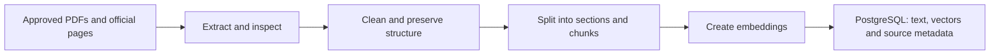

# FAST Student Assistant: one-month pilot

## 1. Product and scope

Build an **English-language assistant for FAST Lahore undergraduates and freshies** that answers university questions with verifiable sources and helps students find past papers.

The first release should handle questions such as:

- “What does the handbook say about attendance?”
- “What happens if I repeat a course?”
- “Where can I find Programming Fundamentals past papers?”
- “What is the currently published admissions deadline?”

Every factual answer should show its source. When information is missing, outdated, or contradictory, the assistant should explain that and offer the relevant official link.

**Month-one coverage:**

| Source | Initial treatment |
|---|---|
| Student handbook and undergraduate academic rules | Full document retrieval with page citations |
| About 10 selected official university/Lahore pages | Indexed content, with freshness checks for current information |
| Academic Time Machine | Searchable resource catalogue for five courses |
| FYP handbook, teacher reviews, timetable sites, Flex and Slate | Clearly labelled links initially |

Start the paper catalogue with Programming Fundamentals, OOP, Data Structures, Digital Logic Design, and Databases. Preserve missing year or campus information as unknown.

Defer FYP OCR ingestion, teacher-review summaries, timetable generation, private portal access, and other campuses until after the pilot.

## 2. Recommended stack

| Layer | Choice | Reason |
|---|---|---|
| Application | Python + Streamlit | Build a usable chat interface while concentrating on RAG |
| Initial RAG | Ordinary Python functions + model SDK | Makes extraction, retrieval, and generation easy to inspect |
| Database | Supabase PostgreSQL + pgvector | Store document text, vectors, resource links, and feedback together |
| Embeddings | `text-embedding-3-small` | Low-cost starting point for the English corpus |
| Answer generation | `gpt-4.1-mini` | Initial model for grounded answers and tool calling |
| Agent workflow | LangGraph, introduced in week four | Explicit routing, tool execution, and bounded retries |
| Hosting | Streamlit Community Cloud + Supabase free tier | Suitable starting point for a small pilot |

Supabase documents combining vector similarity with keyword search, so the same database supports the move from basic to hybrid retrieval. [Supabase hybrid search](https://supabase.com/docs/guides/ai/hybrid-search)

LangGraph can run independently of a full LangChain application; retain the Python functions and expose them as tools later. [LangGraph documentation](https://docs.langchain.com/oss/python/langgraph/overview)

Use a **$20 monthly planning budget**, with an application-side API spending limit of $15 and the remainder reserved. Current listed model prices are $0.40/million input tokens and $1.60/million output tokens; embeddings are $0.02/million tokens. Actual spend depends on traffic and tool usage. [Model pricing](https://developers.openai.com/api/docs/models/gpt-4.1-mini), [embedding pricing](https://developers.openai.com/api/docs/models/text-embedding-3-small)

Hosting starts on free tiers; Supabase’s free tier can pause after inactivity, so this is a pilot deployment assumption. [Streamlit hosting](https://docs.streamlit.io/deploy/streamlit-community-cloud), [Supabase limits](https://supabase.com/pricing)

## 3. Pipeline and interfaces

### Prepare the knowledge

- Adapt the existing extraction scripts per document layout. Check reading order, tables, duplicated text, and PDF-to-printed-page mapping.
- Preserve headings, numbered rules, exceptions, and table labels during cleaning.
- Start with roughly 500-token chunks and 75-token overlap within sections; keep short rules intact.
- Attach document title, source URL, page/section, campus, programme, edition, and retrieval date to every chunk.
- Record content hashes so repeated ingestion does not create duplicates. Only replace searchable content after the replacement passes checks.
- Maintain approved sources in a small registry. Run ingestion locally; refresh website snapshots manually each week during the pilot.

### Basic RAG first

**Question → retrieve relevant passages → generate a supported answer → display citations**

Start with vector retrieval and six passages. Then add PostgreSQL keyword search and combine rankings using reciprocal rank fusion. This helps with exact terms, abbreviations, and course names.

Pass only relevant evidence and recent conversation context to the model. Require source references for factual claims, and validate that returned citation IDs belong to retrieved passages. Citation validity alone does not prove that a claim is supported; evaluation must check both.

Use applicable official sources for university rules. Consider campus, programme, and effective date before treating one source as authoritative. Surface unresolved conflicts.

### Add agentic behavior

**Question → select tool → inspect evidence → answer, clarify, or perform one additional search**

Expose three tools:

- `search_knowledge(query)` — retrieve approved university material.
- `find_papers(course, exam_type?, year?)` — return matching catalogue entries and original links.
- `check_official_page(source_id)` — fetch a registered official page for time-sensitive questions.

The agent can combine tools for a question such as “Explain the repeat-course policy and find OOP papers.”

Limit each turn to three tool calls, including at most one retrieval retry. Treat retrieved content as evidence rather than instructions. Website fetching accepts registered source IDs, with redirects restricted to approved hosts.

If a current-information check fails, show the last checked date and avoid claiming the answer is current.

**Application contract:** return answer text, citations, resource links, and a status such as answered, clarification needed, or insufficient evidence. Keep these functions independent of Streamlit. A separate HTTP API is deferred.

Past papers remain a structured link catalogue in this release; the assistant does not ingest or solve their contents.

## 4. Four-week delivery sequence

| Week | Work | Demonstrable result |
|---|---|---|
| **1: Reliable source text** | Inspect the two core handbooks, fix extraction, preserve source metadata, prepare evaluation questions | Clean passages with correct page references |
| **2: Basic RAG** | Add embeddings, database retrieval, answer generation, and a simple chat interface | Ask handbook questions and inspect supporting passages |
| **3: Better retrieval and resources** | Add keyword retrieval, selected official pages, paper catalogue, citations, and feedback | Useful student assistant with resource finding |
| **4: Bounded agent and pilot** | Add LangGraph routing and official-page checking; evaluate and deploy | Pilot for approximately 5–10 students |

Allocate approximately eight hours per week. If extraction takes longer, reduce website and paper coverage first. Preserve time for evaluation.

Keep the basic RAG path available as a fallback. Enable agent routing for pilot users only after it passes the same answer-quality checks.

## 5. Validation and operating defaults

Create **40 manually checked questions**: 10 development examples and 30 held-out tests. Cover policy lookup, paraphrases, combined questions, paper filtering, ambiguous requests, outdated information, and questions the sources cannot answer.

Pilot acceptance targets:

- Supporting evidence appears in the top six results for at least 90% of answerable retrieval tests.
- At least 90% of answerable held-out responses are correct and supported on manual review.
- Every displayed citation resolves to its actual source.
- No invented rules, deadlines, paper links, or teacher ratings in the test set.
- Missing evidence, source conflicts, failed requests, and tool limits produce clear responses.
- Re-ingestion creates no duplicate active chunks; separate chat sessions do not share history.

Record tool choices, retrieved source IDs, latency, token usage, errors, and optional feedback. Keep ordinary conversation history within the active session; save question/answer examples only when users explicitly submit feedback.

Default to Lahore undergraduate context, English, server-side secrets, and restricted pilot access. Show the assistant as a student project with visible source coverage and dates.

**First implementation milestone:** correctly extract and retrieve a handbook passage for a real student question, then produce an answer with a verified page citation.
