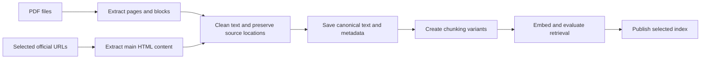

# FAST assistant: preprocessing plan

Planning draft — 7 October 2026. Assumes the Lahore undergraduate pilot described in PLAN.md, with the preference to use LangChain/LangGraph. This document proposes work; extraction, indexing, and experiments have not been run.

**Recommendation:** use two PDF handbooks plus a small selection of official web pages. Preserve their text and provenance in one knowledge store. Compare chunking strategies using real questions before choosing a default. Different content types can use different strategies.

**1. Choose the initial sources**

| Material | Initial treatment | Reason |
| --- | --- | --- |
| Student_Handbook_2026.pdf | Extract and index | Core student policies |
| Academic_Rules_Handbook_2026.pdf | Extract and index | Undergraduate academic rules |
| About 5–10 official university/Lahore pages | Extract and index dated snapshots | Admissions, fees, programmes, and campus information |
| Past-paper resources | Store course/exam/year/campus and original links | Resource finding needs a catalogue initially |
| Faculty, MS, PhD, annual report, FYP PDFs | Defer | Expand after the undergraduate pipeline works |
| Flex, Slate, admissions login, third-party student tools | Store useful links | Outside this initial public-information corpus |

The two core PDFs are present locally. Their extraction quality still needs inspection. FAST's [downloads page](https://www.nu.edu.pk/Downloads) is a starting point for verifying their official source URLs and editions; a local filename alone does not establish an edition or effective date.

**2. Use LangChain components and a repeatable ingestion pipeline**

Use LangChain `Document` objects as a common interface: `page_content` contains the text and `metadata` carries provenance. The existing pilot's Source/Page/Chunk models can remain the application's records, with conversion to Documents where useful.

Start with [PyPDFLoader](https://reference.langchain.com/python/langchain-community/document_loaders/pdf/PyPDFLoader) in page mode. The pilot already lists pdfplumber as a dependency, so compare its extraction on troublesome pages before adding another parser. Choose the extractor based on reading order, rule numbering, and tables. If ordinary extraction misses scanned text, apply OCR to the affected pages and record that fact.

Run ingestion as explicit Python steps using LangChain components. [LangGraph](https://docs.langchain.com/oss/python/langgraph/overview) can orchestrate deterministic and agentic steps; introduce it when resumable ingestion branches or the chatbot's retrieval/live-check routing are useful. Preprocessing does not require an LLM to decide every step.

**3. Validate PDF extraction before comparing chunking**

Inspect 5–10 representative pages per handbook: ordinary paragraphs, numbered rules, a table, and a section spanning pages. Compare extracted text against the rendered PDF.

Clean repeated headers/footers, excess whitespace, and genuine line-wrap artifacts. Preserve headings, rule numbers, lists, table headers, footnotes, exceptions, dates, and numeric thresholds. Do not remove stopwords, lowercase everything, or replace original rules with generated summaries.

Keep immutable raw files and a canonical page/block extraction. Each block must retain its source page. Record physical PDF page numbers separately from printed page labels, and explicitly convert loader indexing to the citation convention. Join a rule across pages only while retaining the page spans of its blocks. Avoid treating a PDF page boundary as a semantic boundary.

Store tables with their row/column meaning intact. If a large table must be divided, repeat its headers in each part. Flag failed pages for review instead of silently indexing incomplete text. Freeze the reviewed extraction before chunking experiments so parser changes cannot confound the results.

**4. Run four initial chunking experiments**

All sizes below are **tokens**, with overlap as a target. They are starting configurations, not established optimal values.

| Experiment | Strategy | Size / overlap | What it tests |
| --- | --- | --- | --- |
| R300 | Recursive splitting of canonical text | 300 / 45 | Focused passages |
| R500 | Recursive splitting of canonical text | 500 / 75 | Baseline balance |
| R800 | Recursive splitting of canonical text | 800 / 120 | More surrounding context |
| S500 | Split into verified sections/rules, then recursively split oversized sections | 500 / 75 within each section | Whether respecting policy structure improves retrieval |

Use `RecursiveCharacterTextSplitter.from_tiktoken_encoder(...)` with an explicitly selected tokenizer. The ordinary recursive splitter measures characters by default; setting `chunk_size=500` alone does not mean 500 tokens. See [recursive splitting](https://docs.langchain.com/oss/python/integrations/splitters/recursive_text_splitter) and [token-based splitting](https://docs.langchain.com/oss/python/integrations/splitters/split_by_token).

Keep each short complete rule together in S500; split oversized rules at paragraph/list boundaries. Include the document title and section breadcrumb in each chunk's retrieval text, applying that enrichment consistently across all experiments and counting its tokens. Preserve the unmodified evidence body for citations.

For web FAQs, prefer a complete question/answer pair; for other pages, use headings and sections. PDF heading detection must be verified—plain PDF extraction does not automatically produce trustworthy Markdown headings.

Initial hypothesis: S500 will suit these policy documents. Confirm that through evaluation. Try semantic chunking later if the first four leave clear failures; it adds another variable and may separate a rule from its exception. Parent/child retrieval is a later option when short chunks retrieve well but answers need the enclosing section.

**5. Choose the winner using evidence retrieval**

Create a focused development set of 20–30 handbook questions. Include exact rule lookups, paraphrases, exceptions, cross-page rules, tables, and questions requiring two passages. Add several unanswerable questions for a separate abstention check. This expands PLAN.md's small development set; preserve its held-out test questions for final validation.

Manually label supporting source passages using source ID, revision, page, and a text span or quote. Do not label using chunk IDs because those change between experiments.

Use identical source snapshots, extraction, embedding model, metadata filters, retrieval method, and questions. Begin with vector retrieval and top six chunks. Store each experiment separately or filter strictly by an index/experiment ID so results never mix.

Record:

- **Evidence hit rate at 6:** fraction of answerable questions with at least one supporting passage retrieved.
- **Complete evidence coverage at 6:** fraction with every required passage, including applicable exceptions, retrieved.
- **Context cost:** retrieved token count and redundant/irrelevant text.
- **Answer support:** manual review of answers and citations for the best two configurations, with the same generation settings.

Also compare complete evidence coverage under one fixed context-token budget, such as 3,000 tokens. Otherwise large chunks receive an unfair information advantage at the same top-k. Define the packing rule consistently, deduplicate overlapping evidence, and record actual tokens used.

Aim for at least 90% evidence hit rate on answerable questions, report the actual numerator/denominator, and inspect failures. Prefer complete evidence and supported answers over a small hit-rate advantage. Freeze the choice before running held-out tests. Evaluate hybrid retrieval as a separate subsequent change.

**6. Add selected website content to the same knowledge store**

Store cleaned website text, embeddings, and metadata alongside PDF chunks. A different input format does not require a separate vector database.

Start with the official [admissions FAQ](https://www.nu.edu.pk/Admissions/FAQ), [schedule](https://www.nu.edu.pk/Admissions/Schedule), and [programmes offered](https://www.nu.edu.pk/Admissions/ProgramOffered). Select fee, scholarship, and relevant Lahore contact/student-service pages through official navigation. Keep the exact approved URLs in the source registry; expand based on unanswered questions.

For static pages, [WebBaseLoader](https://reference.langchain.com/python/langchain-community/document_loaders/web_base/WebBaseLoader) or the existing HTTP/BeautifulSoup dependencies can supply Documents. Extract the main content with page-specific selectors, retaining headings, tables, and relevant links. Remove navigation, repeated menus, and footers. Use browser rendering only if useful content is absent from the fetched HTML.

Identify campus and programme at section level on pages covering multiple audiences; do not mark the whole page undergraduate or Lahore merely because that is the chatbot's default audience. Keep unknown scope unknown.

Save snapshots and content hashes. Refresh manually each week during the pilot; only re-embed changed cleaned content. Fetch only selected public pages, respect site access rules, and use modest request rates. Linked PDFs enter the PDF path and should be deduplicated against existing files.

For questions about a current deadline or fee, recheck the registered official page at answer time. A successful fetch today still does not prove the content describes the current admissions cycle: retain and inspect its stated year/effective period. Distinguish `fetched_at` from a source's `published_at` or `effective_date`. If a live check fails, show when the stored snapshot was last verified and avoid asserting that it is current.

When sources conflict, compare their applicability, edition, and effective date. Surface unresolved disagreements; do not silently choose whichever chunk ranks highest.

**7. Store source records, text, and vectors separately enough to reproduce results**

Retain the planned Supabase PostgreSQL/pgvector database. It supports [hybrid text and vector search](https://supabase.com/docs/guides/ai/hybrid-search) when that experiment is added.

| Record | Essential content |
| --- | --- |
| Sources | Stable ID, official URL, title, kind, intended scope, refresh policy |
| Source revisions | Source ID, raw/clean content hashes, raw-file location, extraction version, fetched/verified dates, stated edition/effective date |
| Canonical blocks | Revision ID, original text, heading path, physical/printed page or HTML section location |
| Index runs | Run ID, splitter configuration, tokenizer, embedding model/dimensions, corpus revisions, active/staged status |
| Chunks | Run/revision IDs, ordinal, text, embedding, source spans, scope metadata |
| Resource links | Course, exam type, year, campus, original URL; unknown fields remain unknown |

Keep raw PDFs/HTML and extraction artifacts on disk initially or in object storage later; reference them from the database. The searchable records need text as well as embeddings—vectors alone cannot supply answer evidence.

Use deterministic chunk identities derived from revision, index configuration, ordinal, and text. Stage and validate a new index before activating it; retire its predecessor so ordinary retrieval returns one active version. Identical re-ingestion must not duplicate active chunks. Preserve provenance when identical passages occur in multiple official sources.

**8. Implement in this order**

1. Extract and visually inspect the academic-rules handbook; establish page citations.
2. Add the student handbook and save reviewed canonical text.
3. Label development questions and run R300, R500, R800, and S500.
4. Select a provisional PDF strategy and publish its index.
5. Add selected website snapshots and web-specific retrieval questions.
6. Validate mixed-source retrieval, freshness handling, and repeat ingestion.
7. Add hybrid retrieval and LangGraph routing as separately evaluated improvements.

**First milestone:** for one real attendance or repeat-course question, retrieve the complete applicable passage with a correct PDF page citation. Build the experiment loop around that observable result.
